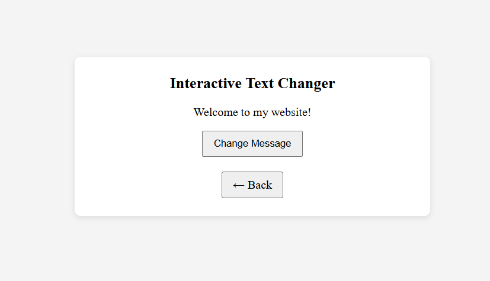
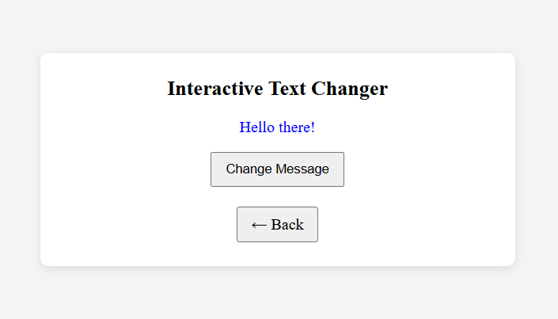
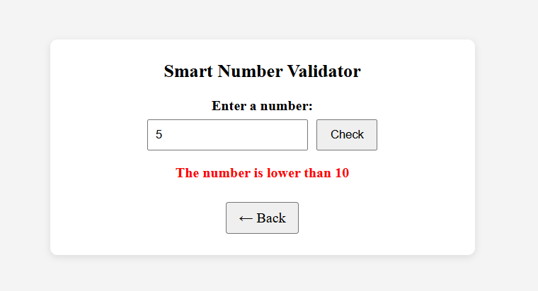
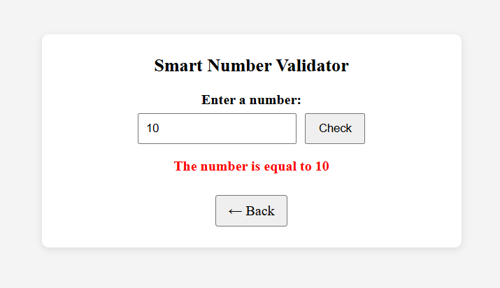
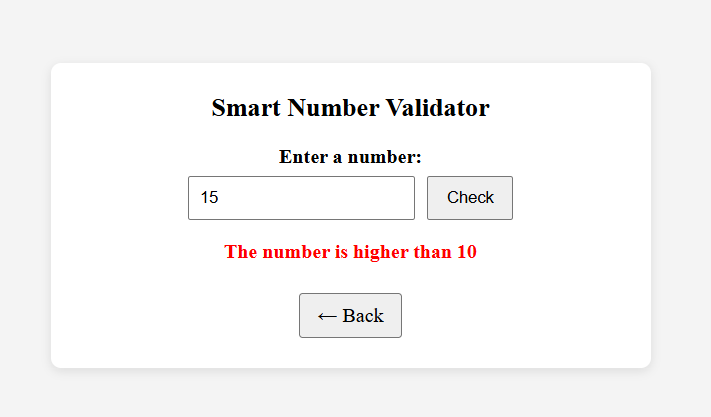
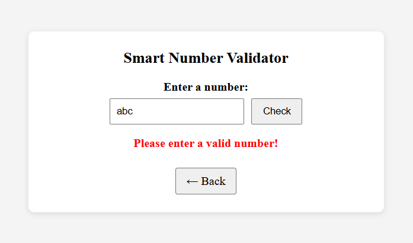
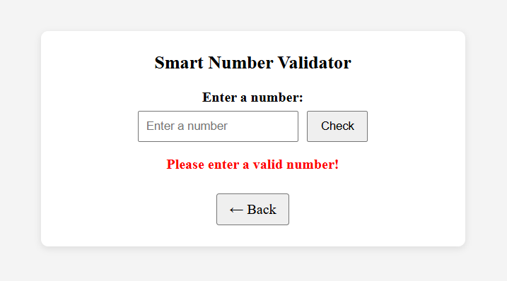
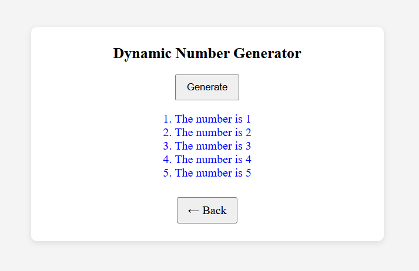

# BIC21203 Lab 4a: Client-Side Scripting (JavaScript)

**Name:** Muhammad Akmal Asri Bin Kamal
**Student ID:** CI250026
**Course:** BIC21203 Web Development
**Faculty:** Faculty of Computer Science and Information Technology, UTHM

**Live demo:** https://akmalencem.github.io/bic21203-lab4a-javascript/

## About

This lab have three pages, all writen in plain HTML5 and JavaScript with no external libraries to update page content, validate user input and generate HTML elements dynamically. Event handling is done with `addEventListener()`, and all text is inserted with `textContent` (no `innerHTML`).

## Project Structure

| File | Description |
| --- | --- |
| `index.html` | Home page that links to Q1, Q2 and Q3 |
| `q1.html` | Question 1: Interactive Text Changer |
| `q2.html` | Question 2: Smart Number Validator |
| `q3.html` | Question 3: Dynamic Number Generator |
| `scriptQ3.js` | JavaScript for Question 3 |

Every question page has a Back button that returns to `index.html`.

## How to Run

Open the live demo link above, or download this repository and open `index.html` in a desktop browser. Then choose a question from the home page.

### Q1: Interactive Text Changer
1. Open `q1.html`. The message "Welcome to my website!" is shown.
2. Click **Change Message**. The paragraph changes to "Hello there!".

The `changeMessage()` function is attached to the button with `addEventListener("click", ...)`.

### Q2: Smart Number Validator
1. Open `q2.html`.
2. Type a value in the input and click **Check**.
3. The message appears below the input:
   - Less than 10: "The number is lower than 10"
   - More than 10: "The number is higher than 10"
   - Equal to 10: "The number is equal to 10"
   - Empty, spaces only or not a number: "Please enter a valid number!"

Tested with `5`, `10`, `15`, `10.5`, `abc` and an empty input. The `checkInput()` function uses an `if...else if...else` structure.

### Q3: Dynamic Number Generator
1. Open `q3.html`.
2. Click **Generate**. An ordered list from "The number is 1" to "The number is 5" appears.
3. Click again. The list is cleared first, so there are no duplicate items.

The `generateNumbers()` function uses a `for` loop with `document.createElement()`, `textContent` and `appendChild()`.

## Screenshots

### Q1

### Q2

### Q3

